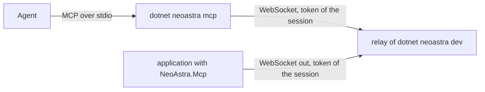

# Agents and MCP

During development, an agent such as Claude Code, Codex, or CodeAlta can look at and drive the pages of an application the
way Chrome DevTools MCP drives Chrome: on the desktop, in the iOS simulator, and on an Android emulator or phone. The tools are
those of [browser automation](browser-automation.md); `dotnet neoastra dev` and `dotnet neoastra mcp` bring them to the
agent over the Model Context Protocol, and the application never listens on a port.



## Setting it up

1. Reference `NeoAstra.Mcp` in development builds and register its plugin. The `neoastra-mobile` template does both:

   ```xml
   <PackageReference Include="NeoAstra.Mcp" Version="..." Condition="'$(Configuration)' == 'Debug'" />
   ```

   ```csharp
   #if DEBUG
   app.UsePlugins((_, plugins) => plugins.AddNeoAstraMcp());
   #endif
   ```

   An application that builds its plugins itself calls `AddNeoAstraMcp()` on its `NeoPluginBuilder`.
2. Start the development session as usual, for example `dotnet neoastra dev --platform ios`, or with
   `--device <UDID>` of a connected iPhone (see [an iPhone](#an-iphone)).
3. Give the agent the MCP server of the project. It is a command that the agent starts in the project folder:

   ```json
   { "mcpServers": { "neoastra": { "command": "dotnet", "args": ["neoastra", "mcp"] } } }
   ```

   The agent may start before or after the session: the server finds the session of the project when it starts and tells the
   agent when the tools change.

## What the agent gets

The server offers the tools of the application that it acts on, with the names, arguments, and answers of Chrome DevTools
MCP (`take_snapshot`, `click`, `fill`, `evaluate_script`, `take_screenshot`, `list_console_messages`, and the others), and two
of its own:

| Tool | Purpose |
| --- | --- |
| `list_apps` | Lists the applications connected to the session: their name, platform, device, and process, and the one the tools act on |
| `select_app` | Chooses the application that the tools act on, by the identifier of `list_apps` |

Without a choice, the tools act on the application that connected last. Without a session, or without an application, a call
says so and what to do instead of waiting. A request that the agent cancels is canceled in the application too, and a call
whose application goes away is answered with an error.

## Embedding the server in a desktop application

A desktop application can also serve MCP itself, without a development session or a relay: the agent starts the application as
the command of its MCP server, and the application serves the tools over its standard input and output.

```csharp
app.UsePlugins((_, plugins) => plugins.AddNeoAstraMcp(new NeoMcpOptions { ServeStandardIo = args.Contains("--mcp") }));
```

```json
{ "mcpServers": { "my-app": { "command": "/path/to/MyApp", "args": ["--mcp"] } } }
```

Start the built executable rather than `dotnet run`, which writes its own output to standard output. While the application
serves, standard output carries MCP alone and what the application writes to the console goes to standard error. The
application quits when the agent closes its standard input. The page may still be loading when the first call arrives: an agent
that waits for a text of the page with `wait_for` before it acts sees the page as the user does.

## How it works

- **The relay.** Every `dotnet neoastra dev` session runs a relay: a WebSocket listener on `127.0.0.1` with a free port and a
  random token of its own. The session gives the address and the token to the application, the same way as the address of the
  development server: in the environment of a desktop backend (`NEOASTRA_MCP_URL`, `NEOASTRA_MCP_TOKEN`), with the
  `SIMCTL_CHILD_` prefix in the iOS simulator, with the `DEVICECTL_CHILD_` prefix on an iPhone, and on Android through
  `adb reverse` of the port of the relay and the file `files/neoastra-development-mcp` beside
  `files/neoastra-development-url`, which only `adb shell run-as` writes. The session removes the forwarding and the file when
  it ends.
- **The application.** The `NeoAstra.Mcp` plugin connects out to the relay and offers the tools of `NeoAutomation`. The
  relay and the application prove the token to each other without sending it: the relay sends a nonce, the application
  answers with an HMAC-SHA256 of it keyed with the token and with a nonce of its own, and the relay answers that one in turn
  before the application runs anything. From then on, every message is sealed with AES-GCM under a key of its direction,
  derived with HKDF-SHA256 from the token and both nonces, and a counter of its direction. It connects again when the relay
  goes away, so the session may restart. Without an address and a token it does nothing, not even create the automation of
  the views. `NeoMcpOptions` sets the options of the automation, such as `AllowScriptEvaluation` and `AllowedDirectories`,
  and may give a relay of its own.
- **The server.** `dotnet neoastra mcp` finds the relay of the session of the project in a discovery file in a folder of the
  user, never in the project, which on macOS and Linux only the user can read. Standard output carries MCP alone.

## An iPhone

An iPhone reaches the machine on the local network only, so `dotnet neoastra dev --platform ios --device <UDID>` with the
UDID of a connected iPhone (as `xcrun devicectl list devices` shows it) works differently from the simulator:

- The tool builds the debug build for `ios-arm64`, signed with the `Apple Development` identity and the profile of the team that
  Xcode manages unless the project sets `CodesignKey`, installs it with `devicectl`, and starts it with its console.
- A development server is trusted on the loopback interface only, which the iPhone does not reach. With the `NeoAstra.Mcp`
  plugin, the application listens on the port of the development server on its own loopback interface, which nothing outside
  the iPhone reaches, and tunnels each connection of its view through its encrypted connection to the relay, which connects
  it to the development server on the machine. The view loads the page from `127.0.0.1` as in the simulator, with the updates
  of the server. An application without the plugin loads the assets of its build instead, and a change of the frontend needs a
  new session.
- The relay listens on the private IPv4 address of the machine in the local network too, where it accepts applications only;
  the iPhone and the machine are on the same network. iOS asks the user once whether the application may find devices on the
  local network: the package adds the `NSLocalNetworkUsageDescription` that the question shows to the `Info.plist` of an iOS
  application (`NeoAstraMcpLocalNetworkUsage=false` leaves it out), and the application connects a moment after the user
  allowed it.

## Security

The relay accepts agents on the loopback interface only, with the token of its session as a bearer token; the token changes
with every session and never enters the project. Applications prove the token without sending it, so the token does not cross
the local network to an iPhone, and neither another machine that pretends to be the relay nor one that pretends to be an
application gets in. After the handshake the connection is encrypted and authenticated: another machine on the local network
can neither read what the tools answer, such as snapshots and screenshots, nor change, replay, reorder, or add a message, which
ends the connection instead. On the local network the relay accepts applications only, and the plugin follows a relay on the
loopback interface or on a private IPv4 address only. Register the plugin in development builds only: a
release build of the template does not reference the package at all. The tools can do what the page can do, run scripts in
it, and, within `AllowedDirectories`, read and write files; narrow them with `NeoMcpOptions.Automation` where that matters.

## Limitations

- The differences of [browser automation](browser-automation.md#how-it-differs-from-chrome-devtools-mcp) from Chrome
  DevTools MCP apply; on a phone `resize_page` is not supported and on Android `new_page` is not either.
- On an iPhone, an application without the `NeoAstra.Mcp` plugin has no development server: a change of the frontend needs
  a new session.
- The embedded server speaks MCP over standard input and output only; an application started by the agent serves one agent.
