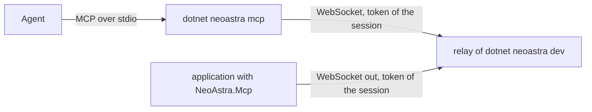

# Agents and MCP

During development, an agent such as Claude Code, Codex, or CodeAlta can look at and drive the pages of an application the
way Chrome DevTools MCP drives Chrome: on the desktop, in the iOS simulator, and on an Android emulator or phone. The tools are
those of [browser automation](browser-automation.md); `dotnet neoastra dev` and `dotnet neoastra mcp` bring them to the
agent over the Model Context Protocol, and the application never listens on a port.



## Setting it up

1. Reference `NeoAstra.Mcp` in development builds and register its plugin. The `neoastra-mobile` template does both:

   ```xml
   <PackageReference Include="NeoAstra.Mcp" Version="..." Condition="'$(Configuration)' == 'Debug'" />
   ```

   ```csharp
   #if DEBUG
   app.UsePlugins((_, plugins) => plugins.AddNeoAstraMcp());
   #endif
   ```

   An application that builds its plugins itself calls `AddNeoAstraMcp()` on its `NeoPluginBuilder`.
2. Start the development session as usual, for example `dotnet neoastra dev --platform ios`.
3. Give the agent the MCP server of the project. It is a command that the agent starts in the project folder:

   ```json
   { "mcpServers": { "neoastra": { "command": "dotnet", "args": ["neoastra", "mcp"] } } }
   ```

   The agent may start before or after the session: the server finds the session of the project when it starts and tells the
   agent when the tools change.

## What the agent gets

The server offers the tools of the application that it acts on, with the names, arguments, and answers of Chrome DevTools
MCP (`take_snapshot`, `click`, `fill`, `evaluate_script`, `take_screenshot`, `list_console_messages`, and the others), and two
of its own:

| Tool | Purpose |
| --- | --- |
| `list_apps` | Lists the applications connected to the session: their name, platform, device, and process, and the one the tools act on |
| `select_app` | Chooses the application that the tools act on, by the identifier of `list_apps` |

Without a choice, the tools act on the application that connected last. Without a session, or without an application, a call
says so and what to do instead of waiting. A request that the agent cancels is canceled in the application too, and a call
whose application goes away is answered with an error.

## How it works

- **The relay.** Every `dotnet neoastra dev` session runs a relay: a WebSocket listener on `127.0.0.1` with a free port and a
  random token of its own. The session gives the address and the token to the application, the same way as the address of the
  development server: in the environment of a desktop backend (`NEOASTRA_MCP_URL`, `NEOASTRA_MCP_TOKEN`), with the
  `SIMCTL_CHILD_` prefix in the iOS simulator, and on Android through `adb reverse` of the port of the relay and the file
  `files/neoastra-development-mcp` beside `files/neoastra-development-url`, which only `adb shell run-as` writes. The session
  removes the forwarding and the file when it ends.
- **The application.** The `NeoAstra.Mcp` plugin connects out to the relay with the token and offers the tools of
  `NeoAutomation`. It connects again when the relay goes away, so the session may restart. Without an address and a token it
  does nothing, not even create the automation of the views. `NeoMcpOptions` sets the options of the automation, such as
  `AllowScriptEvaluation` and `AllowedDirectories`, and may give a relay of its own.
- **The server.** `dotnet neoastra mcp` finds the relay of the session of the project in a discovery file in a folder of the
  user, never in the project, which on macOS and Linux only the user can read. Standard output carries MCP alone.

## Security

The relay listens on the loopback interface only and accepts only connections that present the token of its session; the
token changes with every session and never enters the project. The plugin follows only a relay on the loopback interface.
Register the plugin in development builds only: a release build of the template does not reference the package at all. The
tools can do what the page can do, run scripts in it, and, within `AllowedDirectories`, read and write files; narrow them with
`NeoMcpOptions.Automation` where that matters.

## Limitations

- The differences of [browser automation](browser-automation.md#how-it-differs-from-chrome-devtools-mcp) from Chrome DevTools MCP apply; on a phone `resize_page` is not supported
  and on Android `new_page` is not either.
- A physical iPhone reaches the relay only over the local network, which the tool does not offer yet.
